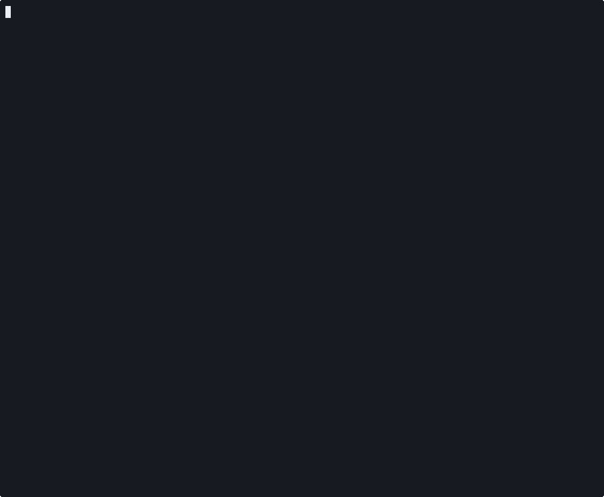

# narvy-cli

Local static security scanner for Android and iOS apps and their source code,
plus Google Play and App Store upload checks for APK, AAB and IPA files.

[](https://pypi.org/project/narvy-cli/)
[](https://pypi.org/project/narvy-cli/)
[](https://github.com/Narvy-Cyber/narvy-cli/blob/main/LICENSE)



## Install

```bash
pipx install narvy-cli      # or: pip install narvy-cli
```

Python 3.10 or later. Android scans need Java 11 or later; if none is found,
a JRE and jadx are downloaded into `~/.narvy/tools` on the first APK scan.
No account is needed. Per-OS notes are in [Install details](#install-details).

## Quick start

```bash
narvy store-check app-release.aab      # Play / App Store upload requirements, offline
narvy scan app-release.apk             # APK, AAB, split APKs, IPA, or a source folder
narvy scan ./repo --output sarif --file results.sarif --fail-on high   # CI gate
```

`narvy store-check` on [InsecureBankv2](https://github.com/dineshshetty/Android-InsecureBankv2),
a deliberately vulnerable Android app (narvy-cli 1.2.2, some detail lines
removed):

```text
$ narvy store-check InsecureBankv2.apk
narvy-store-check 0.3.0  |  InsecureBankv2.apk  (android/apk)
  id=com.android.insecurebankv2 version=1.0 build=1 min_os=15 target_sdk=22
  requirements as of 2026-10-09  |  sha256 b18af2a0e44d7634...

[BLOCKER] PLAY-DEBUGGABLE: Build is debuggable (android:debuggable=true)
    android:debuggable is true. Google Play rejects debuggable APKs and app bundles.
    - evidence: AndroidManifest.xml = true (application@android:debuggable)
    doc: https://developer.android.com/studio/publish/preparing#publishing-configure

[BLOCKER] PLAY-TARGET-SDK: Target API 22 is below Google Play's requirement (API 36)
    - evidence: AndroidManifest.xml = targetSdkVersion=22
    doc: https://developer.android.com/google/play/requirements/target-sdk

[WARNING] PLAY-CLEARTEXT: Cleartext HTTP allowed for all domains (default for target API 22)
[WARNING] PLAY-PERMISSION-DECLARATION: Play Console declaration needed: SMS, Call Log
[NOT DETERMINED] PLAY-CALL-LOG-VERIFICATION: Required from 2027-01-27: READ_CALL_LOG not allowed for account verification by phone call (use not determined)
[PASS] PLAY-16KB-ELF: No 64-bit native library to align for 16 KB pages

Summary: 2 blockers, 2 warnings, 0 info, 1 not determined
NOT READY: at least one blocker
Deterministic checks only. Not a security scan.
```

`narvy scan` on the same APK (progress lines and per-finding detail
removed):

```text
$ narvy scan InsecureBankv2.apk
Found 19 potential issues:
┏━━━━━━━━━━┳━━━━━━━━━━━━━━━━━━━━━━━━━━━━━━━━━━━━━━┳━━━━━━━━━━━━━━━━━━━━━━━━━━━━━━━━━━━━━━┳━━━━━━━━━━━━━━━━━━━━━┳━━━━━━┳━━━━━━━━━━━━┓
┃ Severity ┃ Rule Name                            ┃ File                                 ┃               Lines ┃ Hits ┃ Confidence ┃
┡━━━━━━━━━━╇━━━━━━━━━━━━━━━━━━━━━━━━━━━━━━━━━━━━━━╇━━━━━━━━━━━━━━━━━━━━━━━━━━━━━━━━━━━━━━╇━━━━━━━━━━━━━━━━━━━━━╇━━━━━━╇━━━━━━━━━━━━┩
│ CRITICAL │ Potential secret: hardcoded          │ sources/com/android/insecurebankv2/… │              27, 35 │    2 │   MEDIUM   │
│          │ encryption key (pattern match, not   │                                      │                     │      │            │
│          │ tested)                              │                                      │                     │      │            │
│ CRITICAL │ Application is Debuggable            │ resources/AndroidManifest.xml        │                  32 │    1 │    HIGH    │
│ CRITICAL │ Potential secret: hardcoded          │ sources/com/android/insecurebankv2/… │                  22 │    1 │   MEDIUM   │
│          │ encryption key (pattern match, not   │                                      │                     │      │            │
│          │ tested)                              │                                      │                     │      │            │
│   HIGH   │ Component is Exported without        │ resources/AndroidManifest.xml        │ 49, 56, 60, 64 (+2) │    6 │   MEDIUM   │
│          │ Permission                           │                                      │                     │      │            │
│   HIGH   │ Hardcoded Cryptographic IV           │ sources/com/android/insecurebankv2/… │              26, 34 │    2 │   MEDIUM   │
│          │ (indirect)                           │                                      │                     │      │            │
│   HIGH   │ Application Data Backup is Enabled   │ resources/AndroidManifest.xml        │                  33 │    1 │    HIGH    │
│   HIGH   │ Logging a value that looks like a    │ sources/com/android/insecurebankv2/… │                 117 │    1 │   MEDIUM   │
│          │ credential/token/secret - readable   │                                      │                     │      │            │
│          │ via adb/crash reporters on many      │                                      │                     │      │            │
│          │ devices.                             │                                      │                     │      │            │
│   HIGH   │ JavaScript enabled in WebView - can  │ sources/com/android/insecurebankv2/… │                  30 │    1 │   MEDIUM   │
│          │ enable XSS if untrusted content is   │                                      │                     │      │            │
│          │ loaded.                              │                                      │                     │      │            │
│  MEDIUM  │ Write to Unscoped External Storage   │ sources/com/android/insecurebankv2/… │            163, 181 │    2 │    LOW     │
│  MEDIUM  │ Write to Unscoped External Storage   │ sources/com/android/insecurebankv2/… │              25, 29 │    2 │    LOW     │
└──────────┴──────────────────────────────────────┴──────────────────────────────────────┴─────────────────────┴──────┴────────────┘
Scanned the decompiled app with 48 local rules (28 pattern, 2 taint, 18 structural); 9 of them produced findings.
```

Run `narvy doctor` to check the Java, jadx and iOS tooling, and
`narvy <command> --help` for every flag.

## What it checks

- **Android** (`.apk`, `.aab`, split APKs `.apkm` / `.xapk` / `.apks`, Gradle
  or Kotlin source): manifest settings (debuggable, backup, exported
  components, cleartext traffic), hardcoded secrets and keys, weak
  cryptography (static keys and IVs, ECB, weak hashes), WebView settings,
  insecure storage and logging, TLS trust bypass, native library hardening
  flags (NX, PIE, RELRO, stack canary, RPATH).
- **iOS** (unencrypted `.ipa`, Swift or Objective-C source): Info.plist and
  App Transport Security, Mach-O hardening (PIE, stack canary, ARC), keychain
  accessibility, URL schemes, hardcoded secrets, weak cryptography, TLS trust
  bypass.
- **Web and backend source** (JavaScript/TypeScript, Python, PHP, Go, Ruby,
  Rust, Java/Kotlin; C#/.NET for secrets and dependencies): injection, SSRF,
  XSS, unsafe deserialization, weak cryptography, hardcoded secrets.
- **Dependencies**: known vulnerabilities, matched on your machine against a
  downloaded copy of the [OSV.dev](https://osv.dev) database (see
  [Dependency check](#dependency-check-sca)).
- **Store readiness** (`store-check`): 14 Google Play and 7 App Store checks,
  listed in [Store check](#store-check).

Output: console, JSON, or SARIF for GitHub and GitLab code scanning.
Secret findings are reported as potential: values are masked and never
tested against the service they belong to.

Three other commands work on targets you own, without an app file:
`web-scan` (Nuclei scan of a live URL, passive unless `--active`),
`host-audit` (over your SSH access, with Lynis as the hardening baseline) and
`cloud-scan` (AWS or GCP posture, with your own credentials).

## What leaves your machine

| What | When | Sent to |
|------|------|---------|
| Nothing | `store-check` (no network call) | |
| An ecosystem name (e.g. `npm`), to download its OSV database | `scan`, when the database for that ecosystem is missing or older than 24 h; `db update` | osv-vulnerabilities.storage.googleapis.com |
| Package names, ecosystems and versions, never code or paths | only with `scan --osv-api` | Narvy's EU-hosted OSV mirror (`OSV_API_URL` to change) |
| iOS library names | only with `NARVY_GITHUB_ADVISORIES=1` (never with `--offline`) | api.github.com |
| JRE and jadx downloads | first APK scan, only if Java 11+ or jadx is missing | api.adoptium.net, github.com |
| One anonymous usage event per command (fields listed in [Telemetry](#telemetry)) | every command except `store-check` and `telemetry`, on by default | narvy.io |
| Findings, never code or binary | only with `--upload` (needs `narvy login` or `NARVY_TOKEN`) | your Narvy account |
| With the findings: the app name (the repository name from the git remote, else the folder or file name), the git remote URL with any user, password or token removed (the host is kept), and the branch, when the scanned folder is the root of a git checkout; a local-path or `file://` remote is never sent | only with `scan --upload`, unless `--app` is given | your Narvy account |
| With the findings of an APK, AAB or IPA: its package id (manifest package or CFBundleIdentifier) | only with `scan --upload` | your Narvy account |

`scan --offline` sends nothing: no database or tool download, no usage
event, no GitHub advisory lookup. If jadx or Java is missing for an APK scan,
the code analysis does not run (INCOMPLETE, exit 2 with `--fail-on`); run
`narvy doctor` once while online to install them.

Telemetry is on by default. Turn it off with `narvy telemetry off`,
`NARVY_TELEMETRY=0` or `DO_NOT_TRACK=1`. Semgrep, which runs the structural
rules, is started with its version check and metrics disabled.

## License

Apache License 2.0, rules included. See
[LICENSE](https://github.com/Narvy-Cyber/narvy-cli/blob/main/LICENSE) and
[License details](#license-details).

Project site and hosted dashboard: [narvy.io](https://narvy.io).

---

## Install details

If your shell says `narvy: command not found` / `The term 'narvy' is not
recognized`, pip installed the command into a directory that is not on your
PATH. `python -m narvy` always works (`py -m narvy` on Windows), and prints
once the command that adds that directory to PATH. Narvy never edits PATH
itself.

Optional extras:

```bash
pip install 'narvy-cli[ios-full]'  # full Obj-C introspection for iOS binary scans
pip install 'narvy-cli[cloud]'     # boto3 + google-auth, needed for cloud-scan
```

### Windows

Recommended, with [pipx](https://pipx.pypa.io):

```powershell
py -m pip install --user pipx
py -m pipx ensurepath          # then close and reopen the terminal
pipx install narvy-cli
narvy scan app.apk
```

Without pipx:

```powershell
py -m pip install narvy-cli
py -m narvy scan app.apk
```

To use the short `narvy` command after a plain `pip install`, add pip's
Scripts directory to PATH. For the current PowerShell window only
(Python 3.14 from python.org; change `Python314` to your version):

```powershell
$env:Path += ";$env:APPDATA\Python\Python314\Scripts"
```

To make it permanent for your user account, then open a new terminal:

```powershell
[Environment]::SetEnvironmentVariable("Path", [Environment]::GetEnvironmentVariable("Path", "User") + ";$env:APPDATA\Python\Python314\Scripts", "User")
```

The exact directory is in pip's `WARNING: The script narvy.exe is installed
in ... which is not on PATH` line, and in the hint `py -m narvy` prints. The
Microsoft Store Python uses a different one (under
`%LOCALAPPDATA%\Packages\PythonSoftwareFoundation.Python.3.x_...\LocalCache\local-packages`).
Windows on ARM: semgrep has no Windows ARM64 build, use x64 Python.

### macOS

Homebrew's Python refuses `pip install` outside a virtualenv
(`error: externally-managed-environment`). Use pipx:

```bash
brew install pipx && pipx ensurepath   # then open a new terminal
pipx install narvy-cli
```

or a virtualenv (`python3 -m venv ~/.venvs/narvy && ~/.venvs/narvy/bin/pip install narvy-cli`).
A `pip install --user` puts `narvy` in `~/Library/Python/3.x/bin`, which is
not on PATH: add it with
`echo 'export PATH="$HOME/Library/Python/3.14/bin:$PATH"' >> ~/.zshrc`, or run
`python3 -m narvy`.

### Linux

pipx (`sudo apt install pipx` / `dnf install pipx`, then `pipx ensurepath`) is
the simplest. Debian 12+ and Ubuntu 23.04+ refuse a system-wide `pip install`
the same way Homebrew does. A `pip install --user` puts `narvy` in
`~/.local/bin`; if that is not on PATH, add
`export PATH="$HOME/.local/bin:$PATH"` to `~/.bashrc`, or run
`python3 -m narvy`.

## Usage

```bash
# Android APK/AAB, split bundle, or a Gradle/Kotlin source checkout
narvy scan app-release.apk
narvy scan app.apkm
narvy scan ./my-android-app/

# iOS: unencrypted IPA, or a Swift/Xcode source checkout
narvy scan MyApp.ipa
narvy scan ./my-ios-app/

# Web/backend source (Node, Python, PHP, Go, Ruby, Rust, Java/Kotlin, C#/.NET)
narvy scan ./my-api-repo/

# SARIF output, for CI or GitHub/GitLab code scanning
narvy scan app-release.apk --output sarif --file results.sarif

# Passive web scan of a live URL: no active injection payloads
narvy web-scan https://example.com

# Agentless host hardening audit over your own SSH access
narvy host-audit example.com --user deploy

# AWS account posture check with the standard AWS credential chain
# (profile, env vars, SSO, instance role); --upload sends the findings only
narvy cloud-scan --profile prod --upload

# GCP project posture check with Application Default Credentials
narvy cloud-scan --provider gcp --project my-project

# List recent scans on your Narvy account (requires `narvy login`)
narvy scans

# Scan + upload every .apk/.aab/.apkm/.xapk/.ipa found in a folder, in one command
narvy upload-all ./my-apps-folder/

# CycloneDX SBOM (optionally Ed25519-signed) and CBOM with a PQC score, offline
narvy sbom ./my-app -f sbom.cdx.json
narvy cbom ./my-app -f cbom.cdx.json

# Google Play / App Store upload requirements, offline (not a security scan)
narvy store-check app-release.aab
narvy store-check MyApp.ipa --lang fr --json
```

The console summary table groups hits of the same rule in the same file
into one row, with a hit count and the lines involved. `--no-group` shows
one row per hit. SARIF and JSON output always list every hit.

### Very large Android apps

Decompiling is memory-hungry, and file size is a poor predictor of how much
you need. Before decompiling, the CLI reads the DEX headers to estimate the
Java heap the app needs and sizes the jadx heap from that estimate and the
memory free right now: a small app on a busy 8 GB laptop gets a small heap
instead of a refusal. `--max-mem` sets an upper limit (default `auto`). When
the estimate does not fit in free memory the scan still runs with the
largest heap that does, and says so. If jadx runs out of memory it is
retried once (a bigger heap when memory allows, otherwise one worker
thread), then the scan fails with the numbers. `--force` runs exactly
`--max-mem`, without sizing or retry.

### Sending results to your Narvy dashboard

`narvy login` links the CLI to a Narvy account. Add `--upload` to a scan to
send its results (the findings, never your code or binary) to your account,
where they are de-duplicated, false-positive filtered and kept in the
dashboard history; the CLI prints a direct link to the scan. This needs a
paid plan (Starter and up) and is never on by default. `narvy upload-all
<directory>` does the same for every binary target found in a folder in one
command. `narvy scans` lists recent scans on your account from the terminal.

In CI, set the token in the `NARVY_TOKEN` environment variable instead of
running `narvy login` (narvy.io > Profile > API Credentials). It takes
precedence over a stored login. `NARVY_API_TOKEN` is read as an alias when
`NARVY_TOKEN` is not set. With `--upload`, the token is checked before the
scan starts: a rejected token or an unreachable server exits 4 right away.

### Exit codes

| Code | Meaning |
|------|---------|
| 0 | Scan completed (and nothing reached the `--fail-on` threshold) |
| 1 | `--fail-on`: at least one finding at or above the threshold |
| 2 | `--fail-on`: nothing reached the threshold, but part of the scan did not run (timed-out pass, unreachable CVE database), so it cannot be certified clean |
| 3 | The target or arguments are not usable (path not found, unsupported file type or project, refused URL, invalid option) |
| 4 | The scan, login, upload or report write failed |
| 130 | Interrupted (Ctrl-C, SIGTERM) |

`narvy doctor` exits 0 when every required check passes and 1 when one fails.
Missing optional tools are shown as INFO and do not change its exit code.

### Resource limits

The structural analysis pass runs with at most 4 parallel workers and a
3 GB memory ceiling per analyzed file, so a very large repository does not
exhaust the machine. `NARVY_SEMGREP_JOBS` and `NARVY_SEMGREP_MAX_MEMORY_MB`
(0 = no ceiling) override them; files skipped because of the ceiling are
listed in the scan notes. Outside a terminal (CI logs), a progress line is
printed every 30 seconds; `NARVY_PROGRESS_INTERVAL` changes that (0 = off).

## Store check

`narvy store-check` answers one question: will Google Play or the App Store
accept this build, and what will they ask about it? It reads the manifest,
resources, native libraries, Info.plist, Mach-O load commands, imported
symbols and privacy manifests of the file, and evaluates them against the
store requirements in force at a date (`--as-of`, default today).

```bash
narvy store-check app-release.aab
narvy store-check app.xapk --fail-on warning      # CI gate on warnings too
narvy store-check MyApp.ipa --json > store.json   # EN and FR messages in one report
narvy store-check MyApp.ipa --as-of 2027-02-01    # evaluate a future deadline
```

| Store | Checks |
|-------|--------|
| Google Play | `PLAY-TARGET-SDK`, `PLAY-16KB-ELF`, `PLAY-16KB-ZIPALIGN`, `PLAY-EXPORTED`, `PLAY-DEBUGGABLE`, `PLAY-CLEARTEXT`, `PLAY-FGS-TYPE`, `PLAY-FGS-PERMISSION`, `PLAY-FGS-DECLARATION`, `PLAY-PERMISSION-DECLARATION`, `PLAY-CONTACTS-PERMISSION`, `PLAY-PRECISE-LOCATION`, `PLAY-FGS-GEOFENCING`, `PLAY-CALL-LOG-VERIFICATION` |
| App Store | `APPSTORE-SDK-VERSION`, `APPSTORE-MIN-OS`, `APPSTORE-REQUIRED-REASON-API`, `APPSTORE-PRIVACY-MANIFEST`, `APPSTORE-THIRD-PARTY-SDK`, `APPSTORE-ATS`, `APPSTORE-PURPOSE-STRINGS` |

Each check reports `fail` (severity `blocker`, `warning` or `info`),
`pass`, `not_determined` (the binary does not settle the question) or
`not_applicable`, with the evidence read from the file and the official
page the rule comes from. In `--json`, `title` describes the result for its
status and cites the value read ("Target API 33 is below Google Play's
requirement (API 36)"), and `requirement` holds the rule itself ("Target API
level meets Google Play's current requirement"), both in English and French.
Store values and their sources live in `narvy/store_check/data/`.

Four Google Play policy changes take effect on 2027-01-27: the Contacts
Permissions policy (`READ_CONTACTS` in apps that target API 37+), the
precise location declaration and location button (`ACCESS_FINE_LOCATION`,
`onlyForLocationButton`), geofencing removed as a foreground service use, and
`READ_CALL_LOG` no longer accepted for account verification by phone call.
Before that date their findings read "Required from 2027-01-27". They are
never blockers: what Google requires (a declaration it approves, or a use it
no longer allows) is not in the binary. When the answer depends on how the
app uses a permission or a service, the check reports `not_determined`.

It runs offline: no network call, no telemetry event, nothing written to
disk (the archive is read in memory). It does not check store listing
metadata, Data safety answers, whether a declared permission use is
acceptable under Play policy, or SDK signatures.

Exit codes: 0 no blocker (with `--fail-on warning`, no warning either),
1 at least one blocker (or warning), 3 the file cannot be analysed.

## Dependency check (SCA)

Dependencies are matched on your machine against the public OSV database
([OSV.dev data dumps](https://google.github.io/osv.dev/data/#data-dumps)).
For each ecosystem a scan needs (npm, PyPI, Maven, Go, RubyGems, Packagist,
crates.io, NuGet, SwiftURL), the CLI downloads
`https://osv-vulnerabilities.storage.googleapis.com/<ecosystem>/all.zip`.
The request names the ecosystem and nothing else: no package name, no code,
no path. The file is checked (size, md5, zip integrity), stored as SQLite in
`~/.cache/narvy/osv/` (`$XDG_CACHE_HOME/narvy/osv/` when `XDG_CACHE_HOME` is
set, `NARVY_OSV_DB_DIR` to choose another directory) with a sha256
checked on each use, and downloaded again when older than 24 hours.

```bash
narvy db update                 # refresh the ecosystems already cached
narvy db update -e npm,PyPI     # download these ecosystems
narvy db status                 # what is cached, age, size, damaged files
narvy scan . --offline          # use the cache only, nothing leaves the machine
narvy scan . --osv-api          # previous behaviour: query the OSV API
```

Sizes on disk: npm 301 MB (220 MB download), PyPI 71 MB, Packagist 28 MB,
Maven 27 MB, Go 19 MB, NuGet 14 MB, the others under 10 MB. A refresh builds
the new file next to the old one: for npm, about 820 MB free space is needed
while it runs (old file, zip and new file).

The check is reported INCOMPLETE (exit code 2 with `--fail-on`), never clean,
when an ecosystem's database cannot be used: no copy and no download
possible, `--offline` without a copy, a copy older than 7 days (online or
offline), or a damaged file. A damaged file is moved aside as
`<ecosystem>.db.corrupt` and downloaded again, except with `--offline`. A
copy between 24 hours and 7 days old (refresh failed, or `--offline`) is
used and the scan says how old it is.

`--osv-api` sends each dependency's name, ecosystem and version to Narvy's
EU-hosted OSV mirror, or to `OSV_API_URL` (a base URL, `/query` and
`/querybatch` are appended; `OSV_BATCH_API_URL` overrides the batch URL).
Responses are cached 7 days in `~/.narvy/osv_cache.db`.

Dependencies with no lookup key (an ecosystem OSV does not carry, an iOS
library with no known source repository URL) are counted as unverified.

### CI

Cache `~/.cache/narvy/osv` between runs, or every run downloads the
database again. `narvy init-ci --github`, `--gitlab` and `--bitbucket` write
this for you, and add `--upload` to the scan when a `NARVY_TOKEN` secret or
variable is set (without one the scan stays local).

GitHub Actions, one key per UTC day:

```yaml
- id: osv_day
  run: echo "day=$(date -u +%Y-%m-%d)" >> "$GITHUB_OUTPUT"
- uses: actions/cache/restore@v4
  with:
    path: ~/.cache/narvy/osv
    key: narvy-osv-${{ steps.osv_day.outputs.day }}
    restore-keys: narvy-osv-
- run: narvy scan . --fail-on high
- if: always()
  uses: actions/cache/save@v4
  with:
    path: ~/.cache/narvy/osv
    key: narvy-osv-${{ steps.osv_day.outputs.day }}
```

GitLab caches only paths inside the project and has no date variable for a
key: point `NARVY_OSV_DB_DIR` at `$CI_PROJECT_DIR/.narvy-osv` and cache that
folder with a fixed key and `when: always`; the CLI refreshes a copy older
than 24 hours.

## SBOM and CBOM

Both are offline, CycloneDX 1.6 JSON. They work on a source directory, an
.apk/.aab or an .ipa, alone or as part of a scan.

```bash
narvy sbom ./my-app -f sbom.cdx.json --sign-key key.pem   # signed SBOM
narvy verify-sbom sbom.cdx.json --public-key pub.pem      # exit 0 = valid
narvy cbom ./my-app -f cbom.cdx.json                      # crypto inventory + PQC score
narvy scan ./my-app --sbom sbom.cdx.json --sign-key key.pem --cbom cbom.cdx.json
```

**SBOM.** The dependencies the dependency check reads (npm, PyPI, Packagist,
Go, RubyGems, crates.io, Maven/Gradle, NuGet, CocoaPods, SwiftPM; Maven
coordinates left in an APK; versioned frameworks in an IPA). No
vulnerabilities inside; `narvy scan` does that lookup. Licenses only where
recorded locally: package-lock.json, installed node_modules, composer.lock.
A version taken from a manifest range, not a lockfile, is marked
`manifest-range-floor`.

**Signing.** Ed25519, in the JSF format CycloneDX uses (`signature` at the
root, signed over the canonical JSON). Needs `pip install 'narvy-cli[sign]'`
and an unencrypted PEM key (`openssl genpkey -algorithm ed25519 -out key.pem`).
Without `--sign-key` the SBOM is unsigned and the CLI says so. The embedded
public key only proves the file was not changed; pass `--public-key` to
`verify-sbom` to check who signed it.

**CBOM.** Basic open inventory, not the platform's PQC analysis. It lists
the algorithm families found: in source, at API call sites (regex, comments,
vendored, build and test folders skipped); in an APK, as exact dex string
constants (library code included); in an IPA, CommonCrypto, Security and
CryptoKit symbols and Go crypto packages. No data flow, no key sizes. An APK
that bundles Bouncy Castle lists the post-quantum names it ships, but they
do not count in the score. Score per family found:
`100 * post-quantum / (post-quantum + quantum-vulnerable)`.
Quantum-vulnerable: RSA, ECDSA, ECDH, DH, DSA, X25519, Ed25519. Post-quantum:
ML-KEM, ML-DSA, SLH-DSA. MD5, SHA-1, DES and 3DES are listed as classically
weak and do not change the score. No asymmetric algorithm found gives no
score, not 100.

## Telemetry

The CLI sends one small anonymous event per command (`store-check` sends
none), so we can see which scan types are used and where they fail. It is
sent in the background with a 1 second timeout, is never retried or stored
for later, and never fails a scan. At most it adds 1 second at exit. A
notice is printed the first time it runs.

Exactly these fields are sent:

| Field | Example |
|-------|---------|
| `schema` | `1`, the event format version |
| `install_id` | a random UUID created on first run and stored in `~/.narvy/config.json` (not derived from your machine, user or account) |
| `cli_version`, `python_version`, `os` | `1.3.0`, `3.11`, `linux` / `darwin` / `windows` / `other` |
| `ci` | `true` when a CI environment variable is set |
| `command` | `scan`, `web-scan`, `host-audit`, ... |
| `surface` | `android`, `ios`, `source`, `web`, `host`, `cloud` or `none` |
| `duration_bucket` | `<10s`, `10s-1m`, `1-5m`, `5-15m`, `15-60m`, `>60m` |
| `findings` | per severity, a bucket: `0`, `1-5`, `6-20`, `21-100`, `101-500`, `>500` |
| `exit_code` | the process exit code |
| `error_class` | on a crash, the exception class name only (e.g. `ValueError`), never its message |

Never sent: code, file, project, package or repository names, paths, URLs,
hosts or IPs you scan, finding details, your account id or email.

Turn it off with any of:

```bash
narvy telemetry off        # saved in ~/.narvy/config.json; `narvy telemetry on` to re-enable
export NARVY_TELEMETRY=0
export DO_NOT_TRACK=1
```

`narvy telemetry status` shows the current state. The code is in
[`narvy/telemetry.py`](https://github.com/Narvy-Cyber/narvy-cli/blob/main/narvy/telemetry.py).

## Free rules and premium rules

The CLI ships the community rule set under Apache 2.0: the language-level
rules for every supported language (injection, weak cryptography, dangerous
configuration, storage, WebView, transport), every hardcoded-secret rule, and
the Android and iOS rules. It is the same engine and the same community rules
that Narvy runs on its servers.

Framework-specific rules (Django, Flask, FastAPI, Express, Laravel, Symfony,
Ruby on Rails, Spring and the Java persistence/serialization stack, Gin) and
the C#/.NET code rules are premium: they run when a project is scanned on a
Narvy paid plan, not in the CLI. When a scanned project uses one of those
frameworks, the CLI says so in one line at the end of the scan, with the
number of checks it did not run. It never hides a finding it did compute.

## Known limitations

- Encrypted iOS binaries (the normal App Store distribution state) are
  detected but not decrypted; only the local, static checks that don't need
  the decrypted binary run.
- Web-source coverage depth isn't uniform across all eight languages: Rust
  and C#/.NET have a smaller rule set than the others, and the CLI says so
  in its own output when it applies.
- Only one architecture's native libraries are checked in a multi-ABI
  APK/split bundle.
- Windows: a decompiled file whose full path passes 260 characters is only
  read when Windows long-path support is enabled
  (`LongPathsEnabled`); a very deep package tree in `%TEMP%` can hit it.

See [SETUP.md](https://github.com/Narvy-Cyber/narvy-cli/blob/main/SETUP.md)
for detailed install and troubleshooting steps.

## License details

Apache License 2.0, see
[LICENSE](https://github.com/Narvy-Cyber/narvy-cli/blob/main/LICENSE).

Rule packs under `narvy/rules/` are authored by Narvy
(Apache 2.0, same as the rest of this package) and contain no third-party
rule text.
`host-audit` runs Narvy's own host checks (secrets exposed on disk,
unauthenticated data services, cloud metadata exposure, container/daemon
posture, exposed VCS/artifacts in web roots) and, as the hardening baseline,
shells out to [Lynis](https://cisofy.com/lynis/) (GPL-3.0), auto-fetched at
run time over your SSH access, run arm's-length, never bundled. Lynis is
attributed as the engine in the audit output; its controls are not presented
as Narvy's own.

## Contributing

Issues and pull requests are welcome, in particular new or improved detection
rules. All rule packs are Narvy's own, under `narvy/rules/`: Android/iOS
(`rules/android`, `rules/ios`) and web/backend (`rules/web`). The
web/backend packs run on the Semgrep OSS engine, which Narvy invokes as a
dependency; the rules themselves are authored by Narvy (Apache-2.0).
